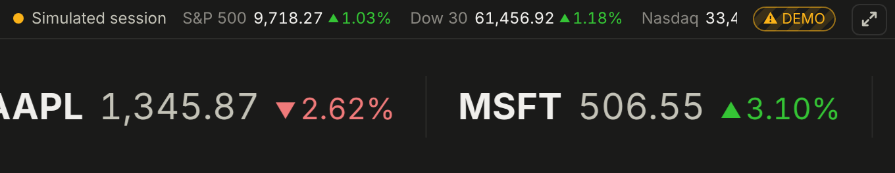
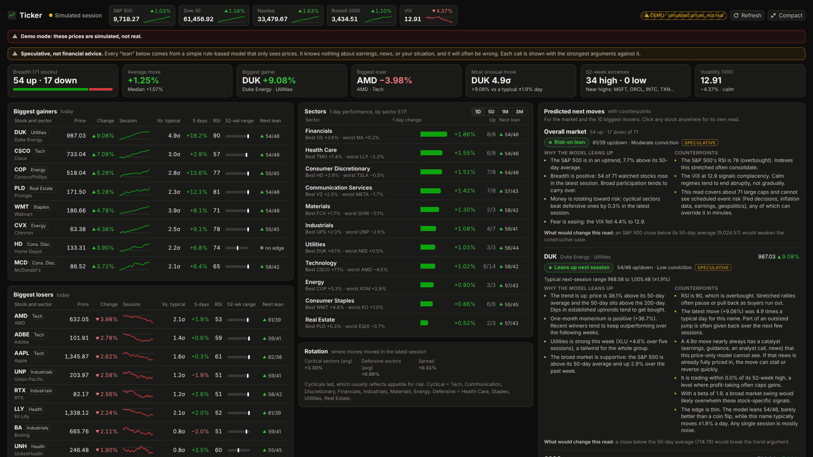

# market-watcher
Small and lightweight vibe coded market watching app

*Screenshots use the built-in demo mode, so the prices shown are simulated.*

A very small app for watching the major US stocks. One window, two forms:

- **Compact ticker.** A small strip with the indexes and a scrolling tape of about 70 large US stocks.
- **Full-screen analysis.** Expand the same window and it becomes a dashboard: biggest movers, sector performance, predicted next moves, and the counterpoints to each prediction.

No install, no account, no API key. The whole app is `index.html` plus a tiny local server that fetches prices.

## Start it

Download this repository (green **Code** button, then **Download ZIP**) and unzip it, or clone it.

**Windows:** double-click `Start Ticker.cmd`. It uses the PowerShell that ships with Windows and opens a small Edge (or Chrome) window with no browser chrome.

**Mac or Linux:** run `python3 server.py` (Python 3.8 or newer, standard library only).

The server listens on `http://localhost:17872` (your machine only; it moves to the next free port if that one is taken) and shuts itself down about three minutes after you close the window.

## Use it

| Do this | To get this |
|---|---|
| Click the expand button, press `F`, or maximize the window | Full-screen analysis |
| Press `Esc`, press `F` again, or click **Compact** | Back to the small ticker |
| Click any stock, sector, or index | Its detail sheet: one-year chart, statistics, prediction, counterpoints |
| Press `R` | Refresh now |
| Make the small window taller | A heat board of every stock appears under the tape |

The window picks its form from its size, so resizing it by hand works too. Prices refresh every minute while the market is open and every ten minutes when it is closed.

Tip: on Windows, PowerToys "Always on Top" (`Win+Ctrl+T`) will pin the compact ticker above other windows.

## What the analysis shows

- **Biggest movers:** top gainers, top losers, and the most unusual moves (each stock's move measured against its own typical day).
- **Sectors:** all 11 sectors ranked over 1 day, 5 days, 1 month, or 3 months, with the best and worst stock in each, plus a cyclical-versus-defensive rotation read.
- **Sector outlook:** predicted winning and losing sectors versus the S&P 500 over the short term (1 to 2 weeks), medium term (1 to 3 months), and long term (6 to 12 months), each with its reasons, a counterpoint, a full ranking of all 11 sectors, and horizon-level caveats.
- **Predicted next moves:** a lean (up, down, or no clear edge) for the overall market and the ten biggest movers, the reasons behind it, a typical next-session price range, and what would change the read.
- **Counterpoints:** every prediction lists the strongest arguments against itself.
- **Prediction scorecard:** how the past leans actually turned out. The app remembers each session's leans and checks them against the next session's close, then shows the hit rate overall, for each of the six signals on its own, and for the overall market lean, next to the share of stocks that rose anyway.
- **Full statistics:** a sortable table of every stock with returns, RSI, volatility, beta, distance from the 52-week high, and volume.

### How the predictions work, and their limits

The "lean" is a weighted blend of six simple, well-known price signals: trend (50-day and 200-day averages), one-month momentum, RSI (overbought or oversold), the size of the latest move, the sector's recent strength, and the broad market's state. The sector outlook works the same way but compares each sector with the S&P 500: one-month relative strength, RSI, and breadth for the short term; three- and six-month relative strength, trend, and market regime for the medium term; twelve-month relative strength, a two-year reversal measure, distance from the 52-week high, the 200-day trend, and volatility for the long term. Signals that agree with the lean are shown as reasons. Signals that disagree are shown as counterpoints, along with structural objections such as "a move this large probably has a news catalyst the model cannot see."

**This is speculative and is not financial advice.** The model sees only prices. It knows nothing about earnings, news, valuations, or your circumstances. The numbers such as "56/44" are a rough score, not a calibrated probability. Expect it to be wrong often.

### The scorecard

The scorecard is the model's real track record, kept next to its claims. While the app shows live prices it records every watched stock's lean for the session (the last one it saw that day). After the following session closes, it compares each lean with where the stock closed, measured from the price at the time of the lean. "No clear edge" reads are not scored.

- It only counts sessions when the app was open with live prices. Saved and demo prices are never recorded.
- It lives in this browser's storage on your machine and is not sent anywhere. **Clear record** (two clicks) erases it.
- It keeps about a year of per-session totals, not every individual lean.
- A few sessions prove nothing. Stocks move together, so the number of sessions matters much more than the number of leans, and a good stretch is not a reason to trade on the leans.

## Where the data comes from

Prices come from Yahoo Finance's public chart feed, which needs no API key. It is an unofficial feed: quotes can lag, and Yahoo could change or limit it at any time.

If the feed cannot be reached, the app falls back in this order and always tells you which one you are looking at:

1. **Live** prices (green badge).
2. **Saved prices** from the last successful update, with the time they were saved.
3. **Demo** mode with clearly labelled simulated prices, so the app still opens. It switches back to live data by itself when the feed returns.

Add `?demo` to the address to force demo mode.

## Change the watchlist

Open `index.html` in a text editor and edit the `WATCHLIST` block near the top of the script. Each line is a sector followed by `SYMBOL Name` pairs separated by `|`. Use Yahoo's symbols (for example `BRK-B`). Save and reload.

## Files

| File | Purpose |
|---|---|
| `index.html` | The whole app: layout, statistics, prediction rules |
| `Start Ticker.cmd` | Windows launcher (double-click) |
| `server.ps1` | Windows local server, run by the launcher |
| `server.py` | Local server for Mac, Linux, or Windows with Python |
| `tests/` | Browser tests and a mock price feed |
| `IMPROVEMENTS.md` | The backlog the weekly improvement run works from |

Both servers accept `--port`/`-Port` to change the port, `--no-open`/`-NoOpen` to skip opening a window, and `--stay`/`-Stay` to keep running after the window closes.

## Development

`tests/run.sh` starts two local servers (one against a mock price feed) and runs about 30 browser checks with Playwright. It needs Python 3, Node, and Playwright with Chromium. Run it before sending a change.

Planned improvements live in [IMPROVEMENTS.md](IMPROVEMENTS.md). A scheduled Claude run picks one item from that list each week and opens a pull request, so editing the list is the way to steer what gets built next.
